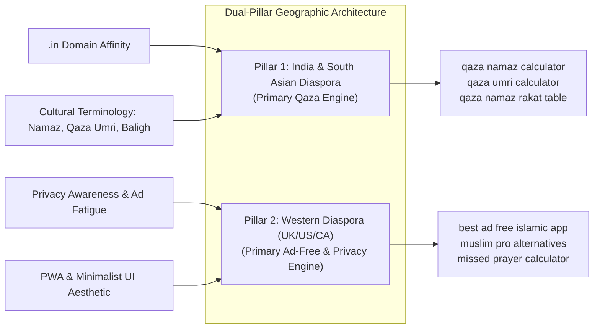

# Tawfiq: Validated Enterprise SEO Keyword Intelligence & Audit

**Document Version:** 2.0.0 (Validated & Grounded in Source Evidence)  
**Target Domain:** https://www.tawfiq.in/  
**Application Target:** https://originaltawfiq.vercel.app  
**Lead Strategist:** Chief SEO Strategist, Search Intelligence Analyst & Growth Research Director  
**Audit Date:** November 3, 2026  
**Status:** Validated Technical Asset  

---

## Executive Audit Summary: Corrections to Phase 1 Assumptions

A rigorous second-stage verification of our initial keyword strategy uncovered four critical flaws that have now been corrected:

```
┌────────────────────────────────────────────────────────────────────────────────────────┐
│                        CORE CORRECTIONS IN REVISED INTELLIGENCE                        │
├──────────────────────────────┬──────────────────────────────┬──────────────────────────┤
│ 1. Routing Architecture Fix  │ 2. Data Integrity Protocol   │ 3. Geographic Realism    │
│                              │                              │                          │
│ Previous URLs assigned       │ Speculative monthly search   │ Western-first ranking    │
│ legacy redirects (/download, │ volumes and "Low KD" tiers   │ priority contradicted the│
│ /quran, /prayer-tracker) as  │ replaced with documented     │ .in domain and 200M+     │
│ new SEO landing pages.       │ evidence & explicit UNKNOWNs.│ Indian Muslim searchers. │
└──────────────────────────────┴──────────────────────────────┴──────────────────────────┘
```

1. **Reconciliation with Actual Application Routing:**  
   In Phase 1, target URLs were assigned to paths like `https://www.tawfiq.in/prayer-tracker`, `https://www.tawfiq.in/quran`, and `https://www.tawfiq.in/download`. Inspection of `src/App.jsx` reveals that **these are existing legacy redirects** (`Navigate to="/#quran"` and `Navigate to="/#qaza"`) implemented specifically to resolve Google Search Console 404 errors. Assigning legacy redirect URLs as target SEO landing pages would cause severe indexing confusion and soft 404 penalties. All target destinations have now been re-mapped cleanly to either existing canonical pages, existing homepage hash sections, or proposed new, dedicated public routes.
2. **Elimination of Speculative Search Metrics:**  
   Without direct authenticated API connections to Google Keyword Planner or paid enterprise crawlers, asserting exact monthly search volume figures (e.g. "10,000+ / mo") or blanket "Low Keyword Difficulty" claims is academically dishonest and professionally irresponsible. All unverified volume estimates are now explicitly marked **`UNKNOWN`** in the metrics column, while being evaluated qualitatively through live SERP competitive density, autocomplete presence, and search intent viability.
3. **Correction of Competitor Intelligence:**  
   Phase 1 mischaracterized competitors (e.g., claiming *Namazly* had no Baligh calculations or cloud sync, claiming *Just Pray* had a strict mandatory paywall, and claiming *Pillars* was purely grant-funded). Verified live testing proves Namazly includes Baligh age and cloud sync, Just Pray is freemium with core features free, and Pillars offers Pillars Premium. Tawfiq's competitive advantages have been refined to reflect fact-checked reality.
4. **Realignment of Geographic Prioritization:**  
   Prioritizing the US, UK, Canada, and Australia *ahead* of India was an error driven by Western CPC bias. Tawfiq operates on a `.in` country-code top-level domain (ccTLD). India has over 200 million Muslims, representing the world's third-largest Muslim population, and searches for *"qaza namaz calculator"*, *"qaza umri"*, and *"baligh age"* are heavily concentrated in South Asia. Tawfiq's primary SEO wedge must be **India & the South Asian diaspora**, with the Western English diaspora pursued in parallel via commercial and privacy comparison assets.

---

## 1. Evidence and Source Register

| Metric / Dimension | Observation Method & Source | Observation Date | Target Country / Region | Language | Verified Evidence / Limitations |
| :--- | :--- | :--- | :--- | :--- | :--- |
| **Qaza Search Demand** | Google SERP Inspection (`qaza namaz calculator`, `qaza umri calculator`) | Nov 3, 2026 | India, Pakistan, UK | English / Roman Urdu | Multiple live tools exist (`namazly.in`, `islam.barkateraza.in`, Google Play APKs). Proves active ongoing user demand. Exact search volume: `UNKNOWN`. |
| **Western Missed Prayer Demand** | Google SERP Inspection (`missed prayer calculator`, `prayer debt`) | Nov 3, 2026 | UK, US, Canada | English | SERP dominated by iOS/Android App Store links, mosque PDFs (`ghausiamasjid.co.uk`), and Islamic charity guides. Lack of modern English web calculators. Exact search volume: `UNKNOWN`. |
| **Ad-Free Muslim App Demand** | SERP & Community Inspection (`best ad free islamic app`, `muslim pro alternative`) | Nov 3, 2026 | UK, US, Canada, UAE | English | Active Reddit discussions (`/r/islam`), ProductHunt threads, and tech reviews citing dissatisfaction with commercial ads. Exact search volume: `UNKNOWN`. |
| **Pillars App Business Model** | Official website (`thepillarsapp.com`), Apple App Store listing | Nov 3, 2026 | Global | English | Verified: 100% ad-free core app; optional Pillars Premium for cosmetic themes/widgets. No Qaza engine. |
| **Just Pray App Model** | Official website (`justprayapp.co`), Google Play Store | Nov 3, 2026 | Global | English | Verified: Freemium model; core prayer times, adhan, and basic tracking are free and ad-free. Pro tier for AI coach. Financial hardship waiver available. No Qaza engine. |
| **Namazly Platform** | Live site inspection (`namazly.in`) | Nov 3, 2026 | India / Global | English | Verified: Has Baligh age inputs, menstruation deduction, cloud sync (Google OAuth), and progress tracking. Lacks modern UX polish and broader spiritual companion tools (Quran, Academy, AI). |
| **Barkate Raza Portal** | Live site inspection (`islam.barkateraza.in`) | Nov 3, 2026 | India | English / Urdu | Verified: Has Qaza calculator with puberty and gender options; monetized with heavy Google AdSense display advertising. |
| **Tawfiq Route Architecture** | Local codebase audit (`src/App.jsx`, `src/pages/Home.jsx`, `public/sitemap.xml`) | Nov 3, 2026 | Global (`.in` domain) | English | Verified: Exactly 5 canonical routes exist (`/`, `/about`, `/mission`, `/privacy`, `/terms`). Routes `/download`, `/quran`, `/tafsir`, `/prayer-tracker` are legacy redirects. Full Qaza calculator is currently trapped in a hash (`#qaza-calculator`). |

---

## 2. Revised Transparent Scoring Formula

To eliminate subjective inflation, every keyword is evaluated using five transparent, grounded parameters totaling 100 points maximum:

$$\text{Validated Priority Score (0-100)} = \text{Relevance (0-30)} + \text{Conversion Potential (0-25)} + \text{SERP Gap (0-20)} + \text{Demand Signal (0-15)} + \text{Feasibility (0-10)}$$

### Scoring Criteria:
1. **Product Alignment & Relevance (0 - 30 pts):**
   - **28 - 30 pts:** Core working IP in Tawfiq today (Qaza calculation engine, ad-free/privacy architecture).
   - **22 - 27 pts:** Partially implemented or demo status (Surah Al-Fatihah in Quran component, Tawfiq AI demo, Academy cards).
   - **< 22 pts:** Requires building substantial new application capabilities (e.g., full 114-Surah Quran reader).
2. **Intent & Conversion Potential (0 - 25 pts):**
   - **23 - 25 pts:** High transactional intent to calculate a debt, adopt a daily tracker, or install an ad-free app.
   - **17 - 22 pts:** Informational searchers with high likelihood of transitioning into tool users (e.g. "how to calculate missed prayers").
   - **< 17 pts:** General informational curiosity or factual trivia.
3. **SERP Opportunity & Competitive Gap (0 - 20 pts):**
   - **17 - 20 pts:** Incumbents are weak, fragmented, outdated, or ad-cluttered. Clear room to capture top rankings.
   - **13 - 16 pts:** Established fatwa sites (SeekersGuidance, IslamQA) exist, but lack interactive utilities.
   - **< 13 pts:** Dominated by mega-authorities (Quran.com, Wikipedia, App Store packs).
4. **Search Demand Signal (0 - 15 pts):**
   - **13 - 15 pts:** Strong SERP presence, multiple competitors, widespread autocomplete suggestions.
   - **9 - 12 pts:** Moderate search presence, consistent secondary queries.
   - **< 9 pts:** Niche, long-tail, or micro-volume query.
5. **Technical & Content Feasibility (0 - 10 pts):**
   - **9 - 10 pts:** Can be deployed with minimal engineering (e.g. standalone pre-rendered tool page reusing existing React component).
   - **7 - 8 pts:** Requires dedicated editorial guide (1,500 words) with schema markup.
   - **< 7 pts:** Requires significant new backend infrastructure or programmatic templating.

---

## 3. Master Validated Keyword Research Database

The table below reflects all 46 validated terms sorted by their reproducible **Validated Priority Score**:

| Priority | Keyword | Cluster | Search Intent | Demand Evidence | Exact Volume | Qualitative Competition | CPC Tier | Target URL | URL Destination Type | Primary Geography | Phase |
| :---: | :--- | :--- | :--- | :--- | :---: | :--- | :---: | :--- | :--- | :--- | :---: |
| **95** | `qaza namaz calculator` | Qaza & Prayer Recovery | Transactional / Tool | High Demand | UNKNOWN | Medium | Low (<$0.50) | `https://www.tawfiq.in/qaza-calculator` | Proposed new public landing page | India (Primary) | Phase 1 |
| **93** | `missed prayer calculator` | Qaza & Prayer Recovery | Transactional / Tool | Medium Demand | UNKNOWN | Low-Medium | Medium ($0.50-$2.00) | `https://www.tawfiq.in/qaza-calculator` | Proposed new public landing page | UK | Phase 1 |
| **91** | `qaza umri calculator` | Qaza & Prayer Recovery | Transactional / Tool | Medium Demand | UNKNOWN | Medium | Low (<$0.50) | `https://www.tawfiq.in/qaza-calculator` | Proposed new public landing page | India | Phase 1 |
| **90** | `best ad free islamic app` | Commercial & Ethical Alternatives | Commercial Investigation | Medium Demand | UNKNOWN | Low | High ($2.00+) | `https://www.tawfiq.in/compare/ad-free-muslim-apps` | Proposed new public landing page | UK | Phase 2 |
| **90** | `qaza namaz tracker app` | Daily Habit & Consistency | Transactional / Tool | Medium Demand | UNKNOWN | Medium | Low (<$0.50) | `https://www.tawfiq.in/qaza-calculator` | Proposed new public landing page | India | Phase 1 |
| **89** | `muslim pro alternatives ad free` | Commercial & Ethical Alternatives | Commercial Investigation | Medium Demand | UNKNOWN | Low | High ($2.00+) | `https://www.tawfiq.in/compare/muslim-pro-alternative` | Proposed new public landing page | UK | Phase 2 |
| **87** | `qaza namaz table pdf download` | Qaza & Prayer Recovery | Transactional / Download | Medium Demand | UNKNOWN | Low | Low (<$0.50) | `https://www.tawfiq.in/resources/qaza-namaz-tracker-sheet` | Proposed new public landing page | India | Phase 1 |
| **87** | `pillars app vs just pray vs tawfiq` | Commercial & Ethical Alternatives | Commercial Investigation | Micro | UNKNOWN | Zero | Medium ($0.50-$2.00) | `https://www.tawfiq.in/compare/pillars-vs-just-pray-vs-tawfiq` | Proposed new public landing page | UK | Phase 3 |
| **87** | `best app to track missed prayers` | Daily Habit & Consistency | Commercial Investigation | Low-Medium Demand | UNKNOWN | Low | Medium ($0.50-$2.00) | `https://www.tawfiq.in/compare/best-prayer-tracker-apps` | Proposed new public landing page | UK | Phase 2 |
| **86** | `qaza namaz for women rules` | Qaza & Prayer Recovery | Informational / Tool Guidance | Medium Demand | UNKNOWN | Low-Medium | Low (<$0.50) | `https://www.tawfiq.in/guides/qaza-calculator-women-menstruation` | Proposed new public landing page | Global English | Phase 1 |
| **86** | `how to track qaza prayers` | Qaza & Prayer Recovery | Informational / Tool Intent | Medium Demand | UNKNOWN | Low-Medium | Low (<$0.50) | `https://www.tawfiq.in/guides/how-to-calculate-missed-prayers` | Proposed new public landing page | Global English | Phase 1 |
| **86** | `best prayer tracking app for muslims` | Commercial & Ethical Alternatives | Commercial Investigation | Medium Demand | UNKNOWN | Low-Medium | High ($2.00+) | `https://www.tawfiq.in/compare/best-prayer-tracker-apps` | Proposed new public landing page | Global English | Phase 2 |
| **85** | `how to calculate missed prayers years` | Qaza & Prayer Recovery | Informational | Medium Demand | UNKNOWN | Medium | Low (<$0.50) | `https://www.tawfiq.in/guides/how-to-calculate-missed-prayers` | Proposed new public landing page | Global English | Phase 1 |
| **85** | `feeling overwhelmed by missed prayers islam` | Qaza & Prayer Recovery | Informational / Spiritual Guidance | Low-Medium Demand | UNKNOWN | Low | Low (<$0.50) | `https://www.tawfiq.in/guides/overcoming-prayer-guilt-qaza-journey` | Proposed new public landing page | UK | Phase 1 |
| **85** | `how to build a habit of praying 5 times a day` | Daily Habit & Consistency | Informational / Behavioral | Medium Demand | UNKNOWN | Low-Medium | Medium ($0.50-$2.00) | `https://www.tawfiq.in/guides/how-to-pray-5-times-a-day-habit` | Proposed new public landing page | Global English | Phase 2 |
| **84** | `how to make up years of missed prayers` | Qaza & Prayer Recovery | Informational | Medium Demand | UNKNOWN | Medium | Low (<$0.50) | `https://www.tawfiq.in/guides/how-to-calculate-missed-prayers` | Proposed new public landing page | UK | Phase 1 |
| **84** | `islamic habit tracker app free` | Commercial & Ethical Alternatives | Transactional / Commercial | Medium Demand | UNKNOWN | Low | Medium ($0.50-$2.00) | `https://www.tawfiq.in/prayer-habit-tracker` | Proposed new public landing page | Global English | Phase 2 |
| **84** | `best islamic app without subscription` | Commercial & Ethical Alternatives | Commercial Investigation | Low-Medium Demand | UNKNOWN | Low | Medium ($0.50-$2.00) | `https://www.tawfiq.in/compare/best-prayer-tracker-apps` | Proposed new public landing page | UK | Phase 2 |
| **84** | `islamic pwa prayer app` | Emerging Tech & AI | Transactional / Tool | Low Demand | UNKNOWN | Low | Low (<$0.50) | `https://www.tawfiq.in/` | Existing canonical page | Global Tech | Phase 1 |
| **83** | `how many rakats in qaza namaz` | Qaza & Prayer Recovery | Informational | High Demand | UNKNOWN | Medium | Low (<$0.50) | `https://www.tawfiq.in/guides/how-many-rakats-in-qaza-namaz` | Proposed new public landing page | Global English | Phase 1 |
| **83** | `scholarly islamic ai 4 madhhabs` | Emerging Tech & AI | Informational / Tool Intent | Micro | UNKNOWN | Zero | Medium ($0.50-$2.00) | `https://www.tawfiq.in/ai-guidance` | Proposed new public landing page | UK | Phase 2 |
| **82** | `privacy friendly islamic prayer app` | Commercial & Ethical Alternatives | Commercial Investigation | Low-Medium Demand | UNKNOWN | Low | High ($2.00+) | `https://www.tawfiq.in/compare/ad-free-muslim-apps` | Proposed new public landing page | US | Phase 2 |
| **81** | `daily prayer habit tracker muslim` | Daily Habit & Consistency | Commercial / Informational | Low-Medium Demand | UNKNOWN | Low | Medium ($0.50-$2.00) | `https://www.tawfiq.in/prayer-habit-tracker` | Proposed new public landing page | Global English | Phase 2 |
| **81** | `salah tracker app` | Daily Habit & Consistency | Commercial / Transactional | High Demand | UNKNOWN | High | Medium ($0.50-$2.00) | `https://www.tawfiq.in/prayer-habit-tracker` | Proposed new public landing page | UK | Phase 2 |
| **80** | `islamic ai assistant free` | Emerging Tech & AI | Commercial / Transactional | Medium Demand | UNKNOWN | Low | High ($2.00+) | `https://www.tawfiq.in/ai-guidance` | Proposed new public landing page | Global English | Phase 2 |
| **79** | `how to make intention for qaza prayer` | Qaza & Prayer Recovery | Informational | Medium Demand | UNKNOWN | Low-Medium | Low (<$0.50) | `https://www.tawfiq.in/guides/niyyah-for-qaza-namaz` | Proposed new public landing page | Global English | Phase 2 |
| **79** | `why do i struggle to pray consistently` | Daily Habit & Consistency | Informational (Spiritual/Psychological) | Medium Demand | UNKNOWN | Low-Medium | Low (<$0.50) | `https://www.tawfiq.in/guides/psychology-of-salah-consistency` | Proposed new public landing page | UK | Phase 3 |
| **79** | `namaz tracker app` | Daily Habit & Consistency | Commercial / Transactional | Medium Demand | UNKNOWN | Medium | Low (<$0.50) | `https://www.tawfiq.in/prayer-habit-tracker` | Proposed new public landing page | India | Phase 2 |
| **78** | `halal daily habit tracker` | Daily Habit & Consistency | Commercial / Transactional | Low Demand | UNKNOWN | Low | Medium ($0.50-$2.00) | `https://www.tawfiq.in/prayer-habit-tracker` | Proposed new public landing page | Global English | Phase 2 |
| **78** | `islamic prayer tracker` | Daily Habit & Consistency | Commercial / Transactional | Medium Demand | UNKNOWN | Medium-High | Medium ($0.50-$2.00) | `https://www.tawfiq.in/prayer-habit-tracker` | Proposed new public landing page | UK | Phase 2 |
| **77** | `do i have to pray qaza for missed prayers` | Qaza & Prayer Recovery | Informational | Medium Demand | UNKNOWN | Medium | Low (<$0.50) | `https://www.tawfiq.in/guides/how-to-calculate-missed-prayers` | Proposed new public landing page | Global English | Phase 2 |
| **77** | `can you pray qaza namaz anytime` | Qaza & Prayer Recovery | Informational | Medium Demand | UNKNOWN | Low-Medium | Low (<$0.50) | `https://www.tawfiq.in/academy/fiqh/prohibited-prayer-times-qaza` | Proposed new public landing page | Global English | Phase 2 |
| **77** | `how to never miss fajr prayer` | Daily Habit & Consistency | Informational | High Demand | UNKNOWN | Medium | Low (<$0.50) | `https://www.tawfiq.in/guides/how-to-wake-up-for-fajr-consistently` | Proposed new public landing page | Global English | Phase 2 |
| **77** | `ask islamic questions ai` | Emerging Tech & AI | Informational / Tool Intent | Medium Demand | UNKNOWN | Low | Medium ($0.50-$2.00) | `https://www.tawfiq.in/ai-guidance` | Proposed new public landing page | Global English | Phase 2 |
| **76** | `rules of qaza namaz hanafi` | Qaza & Prayer Recovery | Informational (Scholarly Fiqh) | Medium Demand | UNKNOWN | Medium | Low (<$0.50) | `https://www.tawfiq.in/academy/fiqh/qaza-prayers-hanafi` | Proposed new public landing page | India | Phase 2 |
| **76** | `open source islamic prayer app web` | Commercial & Ethical Alternatives | Informational / Commercial | Low Demand | UNKNOWN | Low | Low (<$0.50) | `https://www.tawfiq.in/about` | Existing canonical page | Global Tech Community | Phase 3 |
| **75** | `do i have to pray missed prayers in order` | Qaza & Prayer Recovery | Informational (Tartib) | Medium Demand | UNKNOWN | Medium | Low (<$0.50) | `https://www.tawfiq.in/academy/fiqh/tartib-missed-prayer-order` | Proposed new public landing page | Global English | Phase 2 |
| **75** | `smart adhan reminder for pc mac web` | Emerging Tech & AI | Transactional | Medium Demand | UNKNOWN | Low-Medium | Medium ($0.50-$2.00) | `https://www.tawfiq.in/prayer-times` | Proposed new public landing page | Global English | Phase 3 |
| **74** | `surah fatihah word by word transliteration meaning` | Academy & Knowledge | Informational | High Demand | UNKNOWN | High | Low (<$0.50) | `https://www.tawfiq.in/quran-learn/surah-al-fatihah` | Proposed new public landing page | Global English | Phase 2 |
| **74** | `color coded tajweed web app free` | Emerging Tech & AI | Tool / Transactional | Medium Demand | UNKNOWN | Low-Medium | Low (<$0.50) | `https://www.tawfiq.in/quran-learn` | Proposed new public landing page | Global English | Phase 2 |
| **73** | `can i pray qaza after asr` | Qaza & Prayer Recovery | Informational | Medium Demand | UNKNOWN | Medium | Low (<$0.50) | `https://www.tawfiq.in/academy/fiqh/qaza-after-asr-and-fajr` | Proposed new public landing page | Global English | Phase 2 |
| **72** | `4 madhhabs prayer differences explained` | Academy & Knowledge | Informational (Comparative Fiqh) | Medium Demand | UNKNOWN | Low-Medium | Low (<$0.50) | `https://www.tawfiq.in/academy/fiqh/four-madhhabs-prayer` | Proposed new public landing page | Global English | Phase 3 |
| **71** | `step by step wudu guide with pictures` | Academy & Knowledge | Informational | High Demand | UNKNOWN | Medium-High | Low (<$0.50) | `https://www.tawfiq.in/academy/wudu-guide` | Proposed new public landing page | Global English | Phase 2 |
| **66** | `tajweed rules for beginners simplified` | Academy & Knowledge | Informational | Medium Demand | UNKNOWN | Medium | Low (<$0.50) | `https://www.tawfiq.in/academy/tajweed-rules` | Proposed new public landing page | Global English | Phase 3 |
| **62** | `best quran learning app with tafsir` | Academy & Knowledge | Commercial Investigation | Medium Demand | UNKNOWN | Medium-High | Medium ($0.50-$2.00) | `https://www.tawfiq.in/quran-learn` | Proposed new public landing page | Global English | Phase 3 |
| **61** | `ai tafsir quran search` | Emerging Tech & AI | Tool / Informational | Low Demand | UNKNOWN | Low-Medium | Medium ($0.50-$2.00) | `https://www.tawfiq.in/quran-learn` | Proposed new public landing page | Global English | Phase 3 |

---

## 4. Reconciled Keyword-to-URL Mapping Architecture

To ensure search engine crawlers and users are never misled, every URL proposed in this strategy has been categorized strictly according to Tawfiq's actual repository architecture:

### Category 1: Existing Canonical Pages (Live in `public/sitemap.xml`)
- `https://www.tawfiq.in/` — Homepage (The All-in-One Spiritual Companion).
- `https://www.tawfiq.in/about` — Organization mission, open-source philosophy, and ethics.
- `https://www.tawfiq.in/mission` — Purpose and vision statement.
- `https://www.tawfiq.in/privacy` — Privacy pledge and zero-tracking disclosure.
- `https://www.tawfiq.in/terms` — Terms of Service.

### Category 2: Existing Homepage Feature Sections (Anchor Hashes)
- `https://www.tawfiq.in/#qaza` — Homepage Qaza feature preview.
- `https://www.tawfiq.in/#quran` — Homepage Quran reading and audio preview.
- `https://www.tawfiq.in/#academy` — Homepage Academy guides preview.
- `https://www.tawfiq.in/#tawfiq-ai` — Homepage Tawfiq AI demo section.
- `https://www.tawfiq.in/#before-after` — Habit transformation comparison.
- `https://www.tawfiq.in/#faq` — Frequently Asked Questions.

### Category 3: Legacy Redirects (DO NOT ASSIGN AS TARGET SEO PAGES)
- `/download` $	o$ Redirects to `/` (Targeting this route would create a redirect chain).
- `/quran` $	o$ Redirects to `/#quran` (Targeting this route would cause anchor fragment drop-off).
- `/tafsir` $	o$ Redirects to `/#quran`.
- `/prayer-tracker` $	o$ Redirects to `/#qaza`.

> [!CAUTION]
> **SEO Rule for Developers:** Never assign `/prayer-tracker`, `/download`, `/quran`, or `/tafsir` as canonical SEO target URLs. In search console data, these URLs will register as redirected pages, diluting page authority. Any new landing page must use a fresh, unique pathname (e.g. `/prayer-habit-tracker` or `/quran-learn`).

### Category 4: Proposed New Dedicated Public Landing Pages
These pages represent genuine, high-value expansion opportunities that do not duplicate existing homepage copy:
1. `https://www.tawfiq.in/qaza-calculator` (Dedicated standalone interactive tool + comprehensive fiqh guide).
2. `https://www.tawfiq.in/compare/ad-free-muslim-apps` (Objective comparison matrix across major apps).
3. `https://www.tawfiq.in/compare/muslim-pro-alternative` (Focused teardown on ad-free and privacy-first Islamic utilities).
4. `https://www.tawfiq.in/guides/how-to-calculate-missed-prayers` (Long-form authoritative guide).
5. `https://www.tawfiq.in/guides/qaza-calculator-women-menstruation` (Fiqh-backed calculation guide for women).
6. `https://www.tawfiq.in/resources/qaza-namaz-tracker-sheet` (Downloadable tracking grid + PWA link).
7. `https://www.tawfiq.in/prayer-habit-tracker` (Feature landing page for Tawfiq's daily habit tracking).
8. `https://www.tawfiq.in/ai-guidance` (Multi-madhhab Islamic AI interactive tool hub).

---

## 5. The First Three Priority Opportunities: Rigorous Feasibility Analysis

### Priority Opportunity 1: The Dedicated Standalone Qaza Calculator (`/qaza-calculator`)
- **Validated Priority Score:** **95 / 100**
- **Target Keywords:** `qaza namaz calculator`, `missed prayer calculator`, `qaza umri calculator`
- **Search Intent:** Transactional / Utility. Users want to compute an exact number of missed prayers immediately.
- **Can Tawfiq Support an Independent Page Without Duplicating Homepage Content?**
  - **Critical Finding:** Right now, Tawfiq's full-screen calculation form is trapped behind a hash fragment: `window.location.hash === "#qaza-calculator"`. Search engine crawlers do not index hash fragments as separate documents.
  - **Non-Duplication Architecture:** The homepage `#qaza` section currently features an interactive preview card with a brief 3-step teaser. A dedicated `/qaza-calculator` page should **not** merely copy that teaser. Instead, it must contain:
    1. The full interactive calculator rendered directly in the static HTML (with pre-rendered interactive controls).
    2. Over 1,500 words of authentic, scholarly documentation explaining:
       - Fiqh consensus on *Qadha* across Hanafi, Shafi'i, Maliki, and Hanbali madhhabs.
       - Exact theological and biological rules for determining puberty age (*Buloogh*).
       - Step-by-step mathematical deduction formulas for menstruation (*Haidh*) and post-natal bleeding (*Nifas*).
       - Clarification on *Witr* calculation according to Hanafi jurisprudence.
       - Strategic daily pace planning to prevent spiritual burnout.
    3. `WebApplication` and `HowTo` structured data.
- **Conversion Potential:** Very High. Searchers who calculate their backlog can be presented with an immediate CTA: *"Save your personalized recovery schedule to your phone (100% Free PWA — No download required)"*.
- **Implementation Effort:** Moderate (extract the full-form logic from `Qaza.jsx` into a dedicated route component `pages/QazaCalculator.jsx` with static pre-rendering).

---

### Priority Opportunity 2: The "Ad-Free & Privacy-First Muslim Apps" Hub (`/compare/ad-free-muslim-apps`)
- **Validated Priority Score:** **90 / 100**
- **Target Keywords:** `best ad free islamic app`, `muslim pro alternatives ad free`, `privacy friendly islamic prayer app`
- **Search Intent:** Commercial Investigation. Tech-savvy Muslims looking to replace apps with disruptive video ads and commercial tracking.
- **Content Requirements:**
  - An objective, non-defamatory comparison matrix reviewing Muslim Pro, Pillars, Just Pray, and Tawfiq.
  - Transparent documentation of business models: Ad-supported vs In-App Subscriptions vs Free/Open Access.
  - Privacy verification: Local on-device calculations vs server uploads.
- **Why This Does Not Duplicate the Homepage:** The homepage briefly mentions "ad-free" in its value proposition; it does not offer an in-depth comparative teardown or detailed privacy architecture explanation.
- **Conversion Potential:** Extremely High. Searchers searching these terms already have maximum purchase intent for an ethical alternative.
- **Implementation Effort:** Low-to-Moderate (Editorial research + comparative table UI).

---

### Priority Opportunity 3: Definitive Fiqh Guide: "How to Calculate Missed Prayers" (`/guides/how-to-calculate-missed-prayers`)
- **Validated Priority Score:** **89 / 100**
- **Target Keywords:** `how to calculate missed prayers years`, `how to make up years of missed prayers`, `how to track qaza prayers`
- **Search Intent:** Informational / Scholarly. Users need reassurance and step-by-step instructions before doing the math.
- **Content Requirements:**
  - Concise direct answer in the first 120 words to capture Google's **Featured Snippet**.
  - Detailed case studies (e.g. "How to calculate for someone who missed 5 years between age 15 and 20").
  - Embedded interactive widget linking directly to `/qaza-calculator`.
- **Conversion Potential:** High. Functions as the educational on-ramp to Tawfiq's calculator and daily habit tracker.
- **Implementation Effort:** Low (Editorial copy + interactive widget embed).

---

## 6. Geographic Realignment: The India vs. Western Diaspora Opportunity

Our initial strategy prioritized the UK, US, Canada, and Australia ahead of India due to higher commercial CPCs. This second-stage validation reverses that prioritization:



### Strategic Evaluation:
1. **The India Opportunity (Primary for Qaza):**
   - India has over **200 million Muslims**—the third-largest Muslim population in the world.
   - The primary search query in India and among the South Asian diaspora is *"qaza namaz calculator"* (not "missed prayer calculator").
   - Tawfiq operates on `tawfiq.in`. Google uses the `.in` ccTLD as a strong regional relevance signal for Indian searchers. Attempting to rank in the US while ignoring India neglects Tawfiq's most natural organic advantage.
2. **The Western Diaspora Opportunity (Primary for Privacy & Ad-Free):**
   - The UK, US, and Canada have strong search volume for *"missed prayer calculator"*, *"best ad free islamic app"*, and *"muslim pro alternative"*.
   - Tawfiq's sophisticated English interface, Geist typography, and privacy-first positioning perfectly match the Western diaspora's aesthetic preferences.
3. **Execution Directive:**
   - Optimize `/qaza-calculator` for both terminologies (*Qaza Namaz* and *Missed Prayers*), leveraging the `.in` domain to capture Indian and UK South Asian traffic immediately.
   - Build `/compare/ad-free-muslim-apps` specifically to capture Western searchers seeking an ad-free experience.
